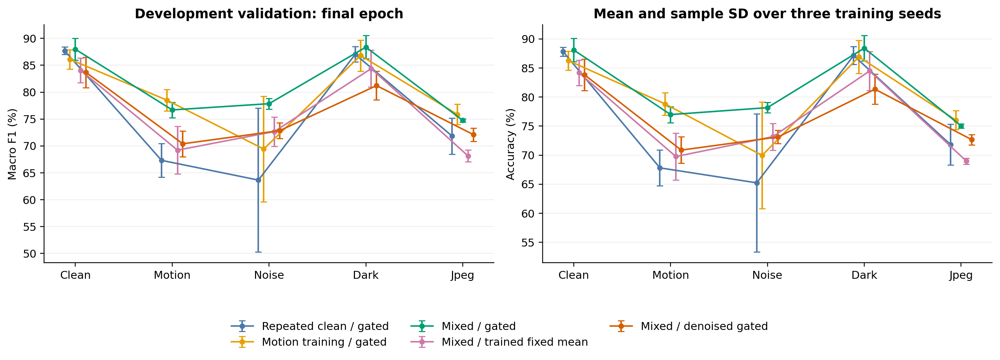
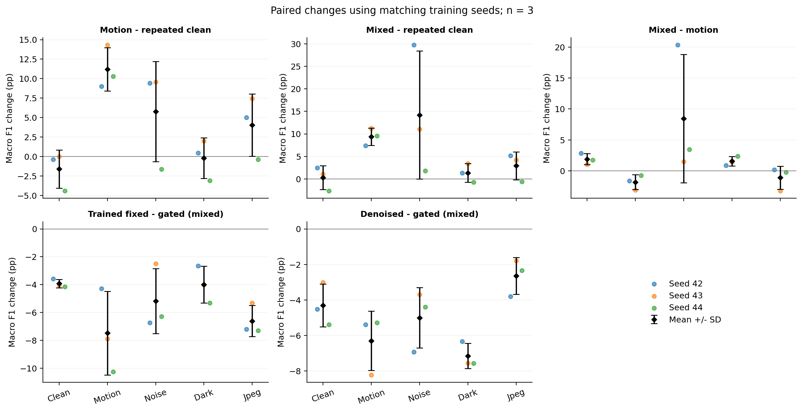
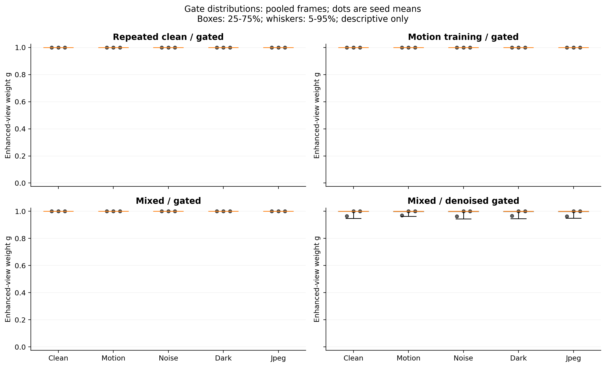
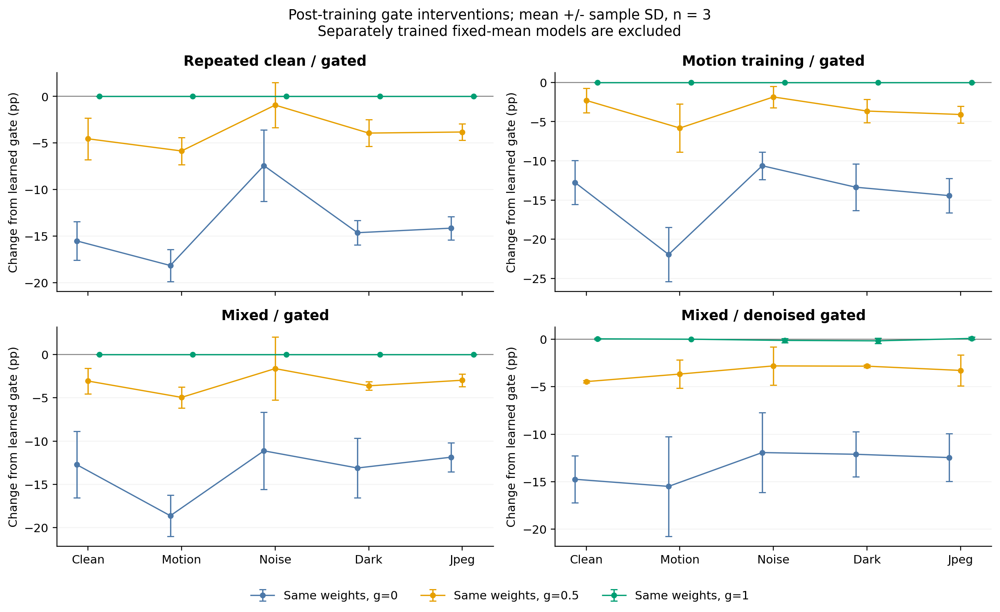
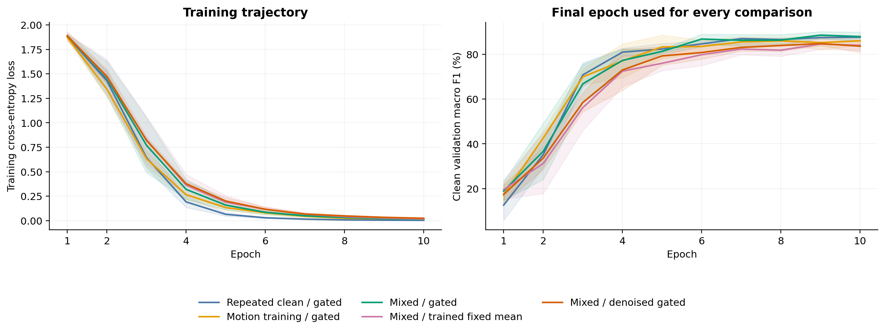

# C 部分：公共 CNN 与融合消融报告

状态：已生成并核验的开发验证报告。读者为项目小组及课程报告整合者。数据来自 `results/study_v1` 的 15 次训练，不包含官方测试。

本次对五种配置各运行三个种子，汇报最终第 10 轮的七类分类结果、配对差值、门控干预和成本。下述差值是固定开发划分上的描述结果，不能据此宣称已经通过独立测试或证明门控有因果机制。

核心结果：mixed 门控相对 targeted_motion 门控的噪声 Macro-F1 平均变化为 +8.43 pp，运动模糊为 -1.82 pp，呈现跨干扰权衡。去噪门控的噪声差值为 -5.01 pp，当前方案没有达到预设噪声收益目标。普通 dual 的门控在所有条件与种子上接近 1，推理近似选择 CLAHE 分支，当前没有输入自适应融合的证据。

## 1. 范围与可追溯证据

- 运行矩阵：门控双分支 × repeat_clean / targeted_motion / mixed × 42、43、44，共 9 次；mixed 下 fixed 与 dual_denoised 各三个种子，共 6 次。
- 类别顺序为 1、2、3、4、5、7、8。固定训练集 2,940 帧、98 条轨迹，开发验证集 840 帧、28 条轨迹，每条轨迹 30 帧，训练和验证没有轨迹交叉。
- 每次训练含 4,410 个条目，其中 2,940 张干净图和 1,470 个额外条目。repeat_clean 的额外条目是原图重复，不是新增独立图像；mixed 的三类干扰各 490 个条目。
- 本程序核验 15 个配置和完整性记录，独立复算 75 条常规指标及 180 条干预指标；共有 63,000 条常规验证预测、151,200 条干预预测和 90 个特征 NPZ。验证条件共用同一批 840 张图，不能将五种条件当成 4,200 个独立样本。
- 原始证据：[配置示例](../../results/study_v1/runs/mixed_dual_denoised_seed42/config.json)、[聚合指标](../../results/study_v1/metrics.csv)、[核验清单](summary_manifest.json)。完整性指纹验证不等同于重新训练得到逐位一致的结果。
- 本次未新增正式的 raw、CLAHE 或 denoised-CLAHE 单分支对照。旧预实验分数不混入当前表，A/B 后续的单分支与统一官方测试仍为缺失证据。

## 2. 模型、训练与视图

输入为 32×32。原始图与增强图共用 3→12→24→32 编码器，每层卷积后接 GroupNorm、ReLU、MaxPool，再经展平和线性投影得到 32 维表示；分类头输出七类。学习门控由两路特征拼接经线性层和 sigmoid 生成标量 g，融合为 `(1-g)·z_raw + g·z_enhanced`。g 越大，增强视图权重越大。

fixed 模型从头训练并在所有样本上固定 g=0.5。dual_denoised 保留原图分支，将增强分支改为双边滤波后 CLAHE：`d=5, sigmaColor=25, sigmaSpace=2`。CLAHE 仅作用于 LAB 的 L 通道，`clipLimit=2.0, tileGridSize=(4,4)`。干扰先作用于 8 位受损图，再生成两种配对视图；增强分支不接收对应干净图。

统一使用 AdamW、学习率 0.003、weight decay 0.01、betas=(0.9, 0.999)、epsilon=1e-8、batch size 128 和 10 轮；每轮 35 次优化更新，共 350 步。三个种子为 42、43、44，所有结果都使用最终轮，不用各组最佳轮挑选成绩。clean、motion、noise、dark、jpeg 是当前五个开发条件；`severity` 的实际标记保留在 CSV，不能将这里的五条件结果写成 13 条件或多强度结论。JPEG 没有加入训练增强。

## 3. 最终轮开发验证结果

表内为 Macro-F1 百分比的三种子均值 ± 样本标准差（`ddof=1`）。准确率的相同统计见 [完整汇总](tables/metric_summary.csv)。标准差描述训练随机性；n=3 很小，不能解释为精确的总体误差或置信区间。

| 配置 | clean | motion | noise | dark | jpeg |
| --- | --- | --- | --- | --- | --- |
| Repeated clean / gated | 87.71 ± 0.69 | 67.32 ± 3.12 | 63.65 ± 13.37 | 87.04 ± 1.44 | 71.84 ± 3.36 |
| Motion training / gated | 86.10 ± 1.77 | 78.52 ± 2.00 | 69.43 ± 9.80 | 86.82 ± 2.89 | 75.86 ± 1.88 |
| Mixed / gated | 87.98 ± 2.01 | 76.70 ± 1.43 | 77.86 ± 0.99 | 88.38 ± 2.15 | 74.76 ± 0.28 |
| Mixed / trained fixed mean | 84.06 ± 2.29 | 69.22 ± 4.44 | 72.68 ± 2.73 | 84.38 ± 3.42 | 68.14 ± 1.11 |
| Mixed / denoised gated | 83.68 ± 2.81 | 70.40 ± 2.39 | 72.85 ± 1.48 | 81.22 ± 2.66 | 72.11 ± 1.23 |

## 4. 按种子配对的比较

每个差值使用同种子、同划分和同条件的两个模型，单位为百分点（pp）。表内的差值标准差直接由三条配对差值计算，不能由两组标准差相减替代。

| 比较（候选减参照） | 条件 | Macro-F1 差值均值 ± SD (pp) | 正差值种子 |
| --- | --- | --- | --- |
| targeted_minus_repeat | clean | -1.61 ± 2.45 | 0/3 |
| targeted_minus_repeat | motion | +11.20 ± 2.78 | 3/3 |
| targeted_minus_repeat | noise | +5.77 ± 6.43 | 2/3 |
| targeted_minus_repeat | dark | -0.22 ± 2.61 | 2/3 |
| targeted_minus_repeat | jpeg | +4.02 ± 4.00 | 2/3 |
| mixed_minus_repeat | clean | +0.28 ± 2.65 | 2/3 |
| mixed_minus_repeat | motion | +9.38 ± 1.93 | 3/3 |
| mixed_minus_repeat | noise | +14.20 ± 14.23 | 3/3 |
| mixed_minus_repeat | dark | +1.34 ± 2.06 | 2/3 |
| mixed_minus_repeat | jpeg | +2.92 ± 3.09 | 2/3 |
| mixed_minus_targeted | clean | +1.89 ± 0.90 | 3/3 |
| mixed_minus_targeted | motion | -1.82 ± 1.19 | 0/3 |
| mixed_minus_targeted | noise | +8.43 ± 10.36 | 3/3 |
| mixed_minus_targeted | dark | +1.56 ± 0.76 | 3/3 |
| mixed_minus_targeted | jpeg | -1.11 ± 1.87 | 1/3 |
| trained_fixed_minus_gated | clean | -3.92 ± 0.30 | 0/3 |
| trained_fixed_minus_gated | motion | -7.48 ± 3.01 | 0/3 |
| trained_fixed_minus_gated | noise | -5.18 ± 2.34 | 0/3 |
| trained_fixed_minus_gated | dark | -3.99 ± 1.33 | 0/3 |
| trained_fixed_minus_gated | jpeg | -6.61 ± 1.12 | 0/3 |
| denoised_minus_gated | clean | -4.30 ± 1.21 | 0/3 |
| denoised_minus_gated | motion | -6.30 ± 1.67 | 0/3 |
| denoised_minus_gated | noise | -5.01 ± 1.70 | 0/3 |
| denoised_minus_gated | dark | -7.15 ± 0.71 | 0/3 |
| denoised_minus_gated | jpeg | -2.65 ± 1.04 | 0/3 |

- **Motion training / gated 相对 Repeated clean / gated**：clean -1.61 pp（0/3 种子为正）；motion +11.20 pp（3/3 种子为正）；noise +5.77 pp（2/3 种子为正）；dark -0.22 pp（2/3 种子为正）；jpeg +4.02 pp（2/3 种子为正）。
- **Mixed / gated 相对 Repeated clean / gated**：clean +0.28 pp（2/3 种子为正）；motion +9.38 pp（3/3 种子为正）；noise +14.20 pp（3/3 种子为正）；dark +1.34 pp（2/3 种子为正）；jpeg +2.92 pp（2/3 种子为正）。
- **Mixed / gated 相对 Motion training / gated**：clean +1.89 pp（3/3 种子为正）；motion -1.82 pp（0/3 种子为正）；noise +8.43 pp（3/3 种子为正）；dark +1.56 pp（3/3 种子为正）；jpeg -1.11 pp（1/3 种子为正）。
- **Mixed / trained fixed mean 相对 Mixed / gated**：clean -3.92 pp（0/3 种子为正）；motion -7.48 pp（0/3 种子为正）；noise -5.18 pp（0/3 种子为正）；dark -3.99 pp（0/3 种子为正）；jpeg -6.61 pp（0/3 种子为正）。
- **Mixed / denoised gated 相对 Mixed / gated**：clean -4.30 pp（0/3 种子为正）；motion -6.30 pp（0/3 种子为正）；noise -5.01 pp（0/3 种子为正）；dark -7.15 pp（0/3 种子为正）；jpeg -2.65 pp（0/3 种子为正）。

这些比较完整保留收益和退步，属于描述性证据；当前没有进行显著性检验。去噪融合相对原门控在噪声至少 +2 pp、clean/motion 不低于 −1 pp、噪声至少 2/3 种子为正这一描述性检查：**未全部满足**。这只对 C 的 mixed 门控参照成立；原计划的主要参照是 CLAHE 单分支，该正式对照尚未生成，因此不能据此宣称完整通过项目的实践价值规则。

## 5. 门控分布与解释边界

下表先在每个运行的 840 帧上求门控均值，再对三个种子均值计算均值 ± SD。“各运行 5–95% 包络”是三个运行中 q05 的最小值至 q95 的最大值，用于观察分布，不是置信区间。逐运行的帧级均值、SD、最小值、5/25/50/75/95% 分位数、最大值及每类分布见 [gate_distribution.csv](tables/gate_distribution.csv)。固定平均模型的 g 恒为 0.5。

普通 dual 的全部九次运行、五种条件共 37,800 条验证预测均满足 g≥0.99，最小 g 为 0.999701；同权重 g=1 干预改变的预测数为 0。因此，当前普通 dual 在这些开发图像的推理中近似选择 CLAHE 分支，没有展现按输入条件灵活融合两路信息的证据。g=1 时分类结果保持一致进一步支持这一描述。这不等同于独立训练的 CLAHE 单分支：编码器和分类头是在双分支训练过程中共同优化的，仍需 A/B 正式对照。

下表每行合并同一运行的五个验证条件（4,200 条预测），分别列出近饱和和数值上恰好为 1 的比例；这些重复图像实例用于描述，不是独立样本。

| 普通 dual 运行 | 最小 g | g≥0.99 比例 | g=1 比例 | 强制 g=1 改变预测数 |
| --- | --- | --- | --- | --- |
| mixed_dual_seed42 | 0.999844 | 100.00% | 0.00% | 0 |
| mixed_dual_seed43 | 0.999701 | 100.00% | 12.38% | 0 |
| mixed_dual_seed44 | 0.999947 | 100.00% | 37.93% | 0 |
| repeat_clean_dual_seed42 | 0.999962 | 100.00% | 6.81% | 0 |
| repeat_clean_dual_seed43 | 0.999998 | 100.00% | 85.69% | 0 |
| repeat_clean_dual_seed44 | 0.999985 | 100.00% | 53.98% | 0 |
| targeted_motion_dual_seed42 | 0.999969 | 100.00% | 0.90% | 0 |
| targeted_motion_dual_seed43 | 0.999995 | 100.00% | 65.24% | 0 |
| targeted_motion_dual_seed44 | 0.999984 | 100.00% | 50.19% | 0 |

| 配置 | 条件 | 运行门控均值 ± 种子 SD | 各运行 5–95% 包络 |
| --- | --- | --- | --- |
| Repeated clean / gated | clean | 1.0000 ± 0.0000 | 1.0000–1.0000 |
| Repeated clean / gated | motion | 1.0000 ± 0.0000 | 1.0000–1.0000 |
| Repeated clean / gated | noise | 1.0000 ± 0.0000 | 1.0000–1.0000 |
| Repeated clean / gated | dark | 1.0000 ± 0.0000 | 1.0000–1.0000 |
| Repeated clean / gated | jpeg | 1.0000 ± 0.0000 | 1.0000–1.0000 |
| Motion training / gated | clean | 1.0000 ± 0.0000 | 1.0000–1.0000 |
| Motion training / gated | motion | 1.0000 ± 0.0000 | 1.0000–1.0000 |
| Motion training / gated | noise | 1.0000 ± 0.0000 | 1.0000–1.0000 |
| Motion training / gated | dark | 1.0000 ± 0.0000 | 1.0000–1.0000 |
| Motion training / gated | jpeg | 1.0000 ± 0.0000 | 1.0000–1.0000 |
| Mixed / gated | clean | 1.0000 ± 0.0000 | 1.0000–1.0000 |
| Mixed / gated | motion | 1.0000 ± 0.0000 | 1.0000–1.0000 |
| Mixed / gated | noise | 1.0000 ± 0.0000 | 1.0000–1.0000 |
| Mixed / gated | dark | 1.0000 ± 0.0000 | 1.0000–1.0000 |
| Mixed / gated | jpeg | 1.0000 ± 0.0000 | 1.0000–1.0000 |
| Mixed / denoised gated | clean | 0.9881 ± 0.0206 | 0.7978–1.0000 |
| Mixed / denoised gated | motion | 0.9902 ± 0.0169 | 0.8300–1.0000 |
| Mixed / denoised gated | noise | 0.9879 ± 0.0209 | 0.8035–1.0000 |
| Mixed / denoised gated | dark | 0.9888 ± 0.0193 | 0.8188–1.0000 |
| Mixed / denoised gated | jpeg | 0.9877 ± 0.0213 | 0.8180–1.0000 |

g 随条件或类别变化只说明当前模型的权重分配与这些分组相关，不能证明门控“识别了噪声”、不能把 g 当成解释性交通语义，也不能由分布变化推出性能收益的因果机制。图中为重复使用的帧分布，帧与同轨迹图像相关；没有把这些帧当成独立重复来生成推断区间。

## 6. 同一权重下的门控干预

本节仅在已经训练好的 learned 模型上替换 g，保持编码器和分类头权重不变。g=0 使用原图特征，g=1 使用增强视图特征，g=0.5 使用两者平均。端点分支仍是在融合训练过程中共同学习得到，不能作为从头训练的单分支模型。这里的 g=0.5 干预与第 3 节独立训练的 fixed 模型是两种不同实验。

| 训练配置 | 条件 | 干预 g | Macro-F1 (%) 均值 ± SD | 相对学习门控 Δ (pp) 均值 ± SD |
| --- | --- | --- | --- | --- |
| Mixed / gated | clean | 0 | 75.26 ± 3.32 | -12.73 ± 3.84 |
| Mixed / gated | clean | 0.5 | 84.92 ± 2.36 | -3.06 ± 1.49 |
| Mixed / gated | clean | 1 | 87.98 ± 2.01 | +0.00 ± 0.00 |
| Mixed / gated | dark | 0 | 75.27 ± 3.11 | -13.11 ± 3.44 |
| Mixed / gated | dark | 0.5 | 84.76 ± 2.09 | -3.62 ± 0.47 |
| Mixed / gated | dark | 1 | 88.38 ± 2.15 | +0.00 ± 0.00 |
| Mixed / gated | jpeg | 0 | 62.89 ± 1.53 | -11.87 ± 1.67 |
| Mixed / gated | jpeg | 0.5 | 71.79 ± 0.66 | -2.97 ± 0.72 |
| Mixed / gated | jpeg | 1 | 74.76 ± 0.28 | +0.00 ± 0.00 |
| Mixed / gated | motion | 0 | 58.07 ± 0.94 | -18.63 ± 2.37 |
| Mixed / gated | motion | 0.5 | 71.75 ± 1.83 | -4.95 ± 1.22 |
| Mixed / gated | motion | 1 | 76.70 ± 1.43 | +0.00 ± 0.00 |
| Mixed / gated | noise | 0 | 66.73 ± 4.01 | -11.13 ± 4.46 |
| Mixed / gated | noise | 0.5 | 76.23 ± 3.53 | -1.63 ± 3.65 |
| Mixed / gated | noise | 1 | 77.86 ± 0.99 | +0.00 ± 0.00 |
| Mixed / denoised gated | clean | 0 | 68.93 ± 5.01 | -14.75 ± 2.49 |
| Mixed / denoised gated | clean | 0.5 | 79.22 ± 2.82 | -4.47 ± 0.12 |
| Mixed / denoised gated | clean | 1 | 83.72 ± 2.85 | +0.04 ± 0.07 |
| Mixed / denoised gated | dark | 0 | 69.11 ± 5.04 | -12.12 ± 2.38 |
| Mixed / denoised gated | dark | 0.5 | 78.38 ± 2.61 | -2.84 ± 0.16 |
| Mixed / denoised gated | dark | 1 | 81.05 ± 2.44 | -0.17 ± 0.29 |
| Mixed / denoised gated | jpeg | 0 | 59.64 ± 2.33 | -12.47 ± 2.51 |
| Mixed / denoised gated | jpeg | 0.5 | 68.82 ± 1.59 | -3.29 ± 1.62 |
| Mixed / denoised gated | jpeg | 1 | 72.19 ± 1.09 | +0.08 ± 0.14 |
| Mixed / denoised gated | motion | 0 | 54.90 ± 5.34 | -15.50 ± 5.25 |
| Mixed / denoised gated | motion | 0.5 | 66.73 ± 1.63 | -3.67 ± 1.49 |
| Mixed / denoised gated | motion | 1 | 70.40 ± 2.39 | +0.00 ± 0.00 |
| Mixed / denoised gated | noise | 0 | 60.91 ± 4.41 | -11.94 ± 4.20 |
| Mixed / denoised gated | noise | 0.5 | 70.04 ± 1.98 | -2.81 ± 2.01 |
| Mixed / denoised gated | noise | 1 | 72.72 ± 1.64 | -0.13 ± 0.22 |
| Repeated clean / gated | clean | 0 | 72.18 ± 2.22 | -15.52 ± 2.08 |
| Repeated clean / gated | clean | 0.5 | 83.16 ± 1.97 | -4.55 ± 2.24 |
| Repeated clean / gated | clean | 1 | 87.71 ± 0.69 | +0.00 ± 0.00 |
| Repeated clean / gated | dark | 0 | 72.40 ± 2.55 | -14.64 ± 1.32 |
| Repeated clean / gated | dark | 0.5 | 83.10 ± 2.24 | -3.94 ± 1.43 |
| Repeated clean / gated | dark | 1 | 87.04 ± 1.44 | +0.00 ± 0.00 |
| Repeated clean / gated | jpeg | 0 | 57.69 ± 3.24 | -14.15 ± 1.26 |
| Repeated clean / gated | jpeg | 0.5 | 68.02 ± 2.62 | -3.82 ± 0.90 |
| Repeated clean / gated | jpeg | 1 | 71.84 ± 3.36 | +0.00 ± 0.00 |
| Repeated clean / gated | motion | 0 | 49.15 ± 2.36 | -18.17 ± 1.74 |
| Repeated clean / gated | motion | 0.5 | 61.46 ± 4.44 | -5.86 ± 1.46 |
| Repeated clean / gated | motion | 1 | 67.32 ± 3.12 | +0.00 ± 0.00 |
| Repeated clean / gated | noise | 0 | 56.22 ± 9.58 | -7.43 ± 3.84 |
| Repeated clean / gated | noise | 0.5 | 62.72 ± 11.02 | -0.93 ± 2.43 |
| Repeated clean / gated | noise | 1 | 63.65 ± 13.37 | +0.00 ± 0.00 |
| Motion training / gated | clean | 0 | 73.33 ± 4.26 | -12.76 ± 2.79 |
| Motion training / gated | clean | 0.5 | 83.81 ± 2.99 | -2.29 ± 1.57 |
| Motion training / gated | clean | 1 | 86.10 ± 1.77 | +0.00 ± 0.00 |
| Motion training / gated | dark | 0 | 73.46 ± 4.41 | -13.36 ± 2.98 |
| Motion training / gated | dark | 0.5 | 83.17 ± 3.62 | -3.65 ± 1.48 |
| Motion training / gated | dark | 1 | 86.82 ± 2.89 | +0.00 ± 0.00 |
| Motion training / gated | jpeg | 0 | 61.43 ± 3.95 | -14.43 ± 2.18 |
| Motion training / gated | jpeg | 0.5 | 71.78 ± 2.84 | -4.09 ± 1.06 |
| Motion training / gated | jpeg | 1 | 75.86 ± 1.88 | +0.00 ± 0.00 |
| Motion training / gated | motion | 0 | 56.58 ± 2.18 | -21.94 ± 3.47 |
| Motion training / gated | motion | 0.5 | 72.71 ± 3.39 | -5.81 ± 3.06 |
| Motion training / gated | motion | 1 | 78.52 ± 2.00 | +0.00 ± 0.00 |
| Motion training / gated | noise | 0 | 58.81 ± 8.54 | -10.62 ± 1.76 |
| Motion training / gated | noise | 0.5 | 67.58 ± 11.08 | -1.85 ± 1.37 |
| Motion training / gated | noise | 1 | 69.43 ± 9.80 | +0.00 ± 0.00 |

干预表反映改变当前融合规则时的预测敏感性，不能单独证明门控的学习机制在真实场景中具有因果优势。完整逐种子结果见 [intervention_by_run.csv](tables/intervention_by_run.csv)。

## 7. 训练状态与固定轮数的限制

表内“最佳轮”仅作为训练状态诊断，不参与模型选择。15 次运行末轮相对各自最佳 clean 验证分数的最大落差为 5.19 pp，最后一轮 clean 分数变化范围为 -5.19 至 +2.45 pp。有限的 10 轮轨迹不能证明全部模型充分收敛；若末端仍变化，应在后续统一协议中检验更长训练，而不能只延长某个落后配置。

| 运行 | 首轮 → 末轮训练损失 | 末轮损失变化 | 末轮验证变化 (pp) | 诊断最佳轮 | 末轮减最佳 (pp) |
| --- | --- | --- | --- | --- | --- |
| mixed_dual_denoised_seed42 | 1.9256 → 0.0244 | -0.0042 | +1.44 | 8 | -1.59 |
| mixed_dual_denoised_seed43 | 1.8393 → 0.0212 | -0.0163 | +0.22 | 10 | +0.00 |
| mixed_dual_denoised_seed44 | 1.8974 → 0.0270 | -0.0070 | -5.19 | 9 | -5.19 |
| mixed_dual_seed42 | 1.9051 → 0.0069 | -0.0050 | +0.23 | 10 | +0.00 |
| mixed_dual_seed43 | 1.8702 → 0.0100 | -0.0119 | -1.17 | 9 | -1.17 |
| mixed_dual_seed44 | 1.8878 → 0.0168 | -0.0077 | -1.02 | 9 | -1.02 |
| mixed_fixed_seed42 | 1.9116 → 0.0131 | -0.0049 | -0.75 | 9 | -0.75 |
| mixed_fixed_seed43 | 1.8705 → 0.0154 | -0.0131 | -0.44 | 9 | -0.44 |
| mixed_fixed_seed44 | 1.8876 → 0.0176 | -0.0145 | -0.56 | 9 | -0.56 |
| repeat_clean_dual_seed42 | 1.9014 → 0.0025 | -0.0010 | +0.13 | 10 | +0.00 |
| repeat_clean_dual_seed43 | 1.8644 → 0.0028 | -0.0012 | +0.28 | 10 | +0.00 |
| repeat_clean_dual_seed44 | 1.8851 → 0.0038 | -0.0023 | +0.09 | 10 | +0.00 |
| targeted_motion_dual_seed42 | 1.8956 → 0.0093 | -0.0026 | -1.63 | 9 | -1.63 |
| targeted_motion_dual_seed43 | 1.8419 → 0.0145 | -0.0044 | +2.45 | 7 | -0.17 |
| targeted_motion_dual_seed44 | 1.8829 → 0.0170 | -0.0068 | +1.71 | 8 | -0.48 |

## 8. 参数与时间成本

表内为三种子均值 ± 样本 SD。训练共计 147.43 秒（累加各次记录，不代表并行任务的实际总墙钟时间）；训练计时排除逐轮验证和导出。所有运行的线程数相同。 前向记录包括已准备视图的批次选择、设备传输、模型前向及 CPU 输出收集，按同一批验证图摊算；它不包括磁盘读取和原始图预处理，且不是逐张在线延迟的测量。训练、导出和各评估条件前向耗时分别见 [逐运行成本](tables/cost_by_run.csv) 与 [条件耗时](tables/inference_cost.csv)。预处理记录来自运行配置，每次构建同时生成 raw、CLAHE 和 denoised-CLAHE 三种视图，可被各运行复用，不应再次加总为独立执行成本，也不能拆解为某种单视图方法的耗时。

| 配置 | 参数 | 线程 | 训练 (s) | 导出 (s) | clean 前向 (ms/图) |
| --- | --- | --- | --- | --- | --- |
| Repeated clean / gated | 26676 | 6 | 9.27 ± 0.24 | 2.03 ± 0.05 | 0.0867 ± 0.0038 |
| Motion training / gated | 26676 | 6 | 9.69 ± 0.20 | 2.13 ± 0.09 | 0.0899 ± 0.0024 |
| Mixed / gated | 26676 | 6 | 10.44 ± 0.76 | 2.13 ± 0.09 | 0.0918 ± 0.0028 |
| Mixed / trained fixed mean | 26611 | 6 | 9.94 ± 0.43 | 0.76 ± 0.03 | 0.0859 ± 0.0116 |
| Mixed / denoised gated | 26676 | 6 | 9.81 ± 0.43 | 2.19 ± 0.14 | 0.0921 ± 0.0037 |

这些成本只对应记录中的环境及当前执行方式。预处理对去噪方案的代价需要与前向耗时分开看。

另有 [小规模端到端核验计时](../../results/c_smoke/verification.json) 可作粗略成本观察：同一环境的 mixed、seed42 各训练 1 轮，并对同一批 840 张 clean 验证图前向。

| 核验模式 | 参数 | 1 轮训练 (s) | 840 图 clean 前向 (s) |
| --- | --- | --- | --- |
| raw 单分支 | 26611 | 0.4684 | 0.02960 |
| dual 门控 | 26676 | 1.1117 | 0.07857 |

该次结果属于端到端功能核验，不属于正式性能对照。每种模式只有一次计时，没有重复与稳态基准控制，因此只能说明当前执行中融合开销较大，不报告精确稳定的速度比，也不将该模型的分类分数混入正式表。正式比较还需 A/C 在同一机器和缓存条件下多次复测，并分开记录单种视图预处理成本。

## 9. 核验、局限与后续交接

汇总程序先执行 `verify_completed_run(run_dir, config)` 检查每个运行，再独立检查矩阵、固定协议、七类标签、75 条常规指标、180 条干预指标、预测重复、图像/轨迹/标签配对、六个 NPZ 的 32 维特征及元数据，以及末轮训练日志与导出指标一致性。Macro-F1 始终固定包含全部七类，零分母类别按 0 计；准确率从逐图预测重算。原始实验产物的 SHA-256 及生成时间保留于 [summary_manifest.json](summary_manifest.json)。

研究根部 `run_config.json` 的矩阵必须与十五种组合完全一致；每次运行去掉运行 ID、种子、输入、增强和预处理计时字段后，其余所有配置字段必须与研究公共配置逐项相等，缺失或额外字段都会拒绝汇总。

独立重载核验记录 [checkpoint_verification.json](../../results/study_v1/checkpoint_verification.json) 已通过：15 次运行共 107,100 个图像/条件实例的特征、预测与门控，以及 151,200 条干预预测与原始导出匹配。这项记录由训练后的独立核验产生，与本汇总程序的指标重算分别执行。

当前报告限定于七类、一个固定开发划分、28 条验证轨迹、合成干扰、五个条件和三个训练种子。不同帧、条件、种子都复用同一验证图，不能把 63,000 行当成 63,000 个独立观测。本文没有构建逐帧 IID 置信区间；D 如需配对 bootstrap，应以整条轨迹为单位、按类别分层，在一次重采样中同时保留所有条件与配对种子，并明确区间仅描述这一固定开发划分。

后续由 A/B 补齐正式单分支对照与统一多强度评估，由 D 在干净训练特征上拟合 PCA/KMeans 并验证开发表示，不在验证特征上拟合后报告泛化。全组先冻结候选清单再打开官方七类测试集。官方测试未在本报告中使用，也不能把本报告趋势外推到全部 43 类或真实道路。

复现命令、产物契约、失败处理及环境信息入口见 [README](README.md)。

## 附录：全部逐种子配对差值

| 比较 | 条件 | 种子 | Macro-F1 Δ (pp) |
| --- | --- | --- | --- |
| targeted_minus_repeat | clean | 42 | -0.399 |
| targeted_minus_repeat | clean | 43 | -0.000 |
| targeted_minus_repeat | clean | 44 | -4.433 |
| targeted_minus_repeat | motion | 42 | +8.988 |
| targeted_minus_repeat | motion | 43 | +14.325 |
| targeted_minus_repeat | motion | 44 | +10.286 |
| targeted_minus_repeat | noise | 42 | +9.410 |
| targeted_minus_repeat | noise | 43 | +9.559 |
| targeted_minus_repeat | noise | 44 | -1.646 |
| targeted_minus_repeat | dark | 42 | +0.433 |
| targeted_minus_repeat | dark | 43 | +1.995 |
| targeted_minus_repeat | dark | 44 | -3.097 |
| targeted_minus_repeat | jpeg | 42 | +5.007 |
| targeted_minus_repeat | jpeg | 43 | +7.441 |
| targeted_minus_repeat | jpeg | 44 | -0.380 |
| mixed_minus_repeat | clean | 42 | +2.449 |
| mixed_minus_repeat | clean | 43 | +1.060 |
| mixed_minus_repeat | clean | 44 | -2.673 |
| mixed_minus_repeat | motion | 42 | +7.382 |
| mixed_minus_repeat | motion | 43 | +11.227 |
| mixed_minus_repeat | motion | 44 | +9.539 |
| mixed_minus_repeat | noise | 42 | +29.749 |
| mixed_minus_repeat | noise | 43 | +11.054 |
| mixed_minus_repeat | noise | 44 | +1.810 |
| mixed_minus_repeat | dark | 42 | +1.321 |
| mixed_minus_repeat | dark | 43 | +3.411 |
| mixed_minus_repeat | dark | 44 | -0.718 |
| mixed_minus_repeat | jpeg | 42 | +5.171 |
| mixed_minus_repeat | jpeg | 43 | +4.187 |
| mixed_minus_repeat | jpeg | 44 | -0.608 |
| mixed_minus_targeted | clean | 42 | +2.849 |
| mixed_minus_targeted | clean | 43 | +1.061 |
| mixed_minus_targeted | clean | 44 | +1.759 |
| mixed_minus_targeted | motion | 42 | -1.606 |
| mixed_minus_targeted | motion | 43 | -3.097 |
| mixed_minus_targeted | motion | 44 | -0.747 |
| mixed_minus_targeted | noise | 42 | +20.338 |
| mixed_minus_targeted | noise | 43 | +1.495 |
| mixed_minus_targeted | noise | 44 | +3.457 |
| mixed_minus_targeted | dark | 42 | +0.888 |
| mixed_minus_targeted | dark | 43 | +1.416 |
| mixed_minus_targeted | dark | 44 | +2.379 |
| mixed_minus_targeted | jpeg | 42 | +0.164 |
| mixed_minus_targeted | jpeg | 43 | -3.254 |
| mixed_minus_targeted | jpeg | 44 | -0.228 |
| trained_fixed_minus_gated | clean | 42 | -3.580 |
| trained_fixed_minus_gated | clean | 43 | -4.035 |
| trained_fixed_minus_gated | clean | 44 | -4.150 |
| trained_fixed_minus_gated | motion | 42 | -4.290 |
| trained_fixed_minus_gated | motion | 43 | -7.898 |
| trained_fixed_minus_gated | motion | 44 | -10.266 |
| trained_fixed_minus_gated | noise | 42 | -6.748 |
| trained_fixed_minus_gated | noise | 43 | -2.495 |
| trained_fixed_minus_gated | noise | 44 | -6.293 |
| trained_fixed_minus_gated | dark | 42 | -2.663 |
| trained_fixed_minus_gated | dark | 43 | -4.007 |
| trained_fixed_minus_gated | dark | 44 | -5.315 |
| trained_fixed_minus_gated | jpeg | 42 | -7.215 |
| trained_fixed_minus_gated | jpeg | 43 | -5.318 |
| trained_fixed_minus_gated | jpeg | 44 | -7.311 |
| denoised_minus_gated | clean | 42 | -4.514 |
| denoised_minus_gated | clean | 43 | -3.007 |
| denoised_minus_gated | clean | 44 | -5.391 |
| denoised_minus_gated | motion | 42 | -5.397 |
| denoised_minus_gated | motion | 43 | -8.229 |
| denoised_minus_gated | motion | 44 | -5.278 |
| denoised_minus_gated | noise | 42 | -6.929 |
| denoised_minus_gated | noise | 43 | -3.692 |
| denoised_minus_gated | noise | 44 | -4.402 |
| denoised_minus_gated | dark | 42 | -6.331 |
| denoised_minus_gated | dark | 43 | -7.557 |
| denoised_minus_gated | dark | 44 | -7.572 |
| denoised_minus_gated | jpeg | 42 | -3.807 |
| denoised_minus_gated | jpeg | 43 | -1.789 |
| denoised_minus_gated | jpeg | 44 | -2.345 |
