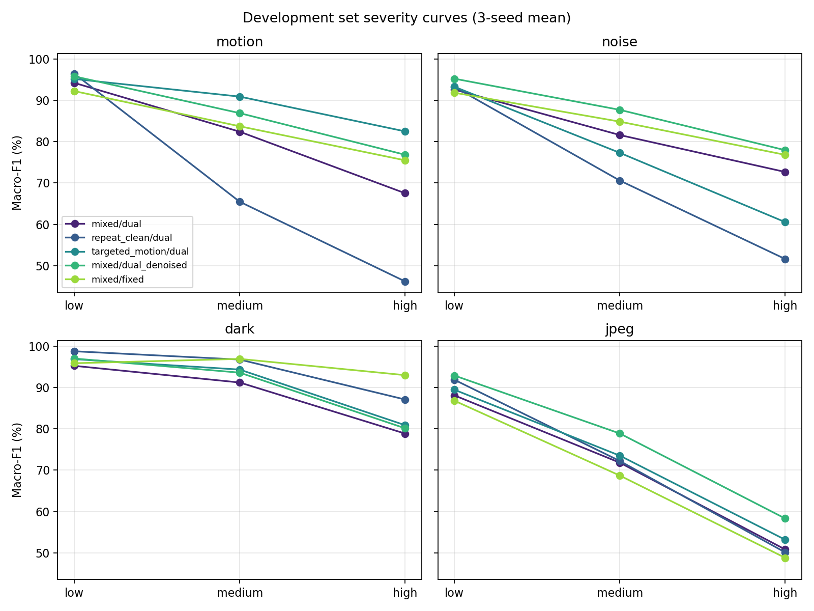

# C 部分 ResNet18 十三条件开发集评估

这次评估加载 C 此前完成的 15 个最终轮权重，在 A 冻结的 13 个条件下评估同一批 840 张开发验证图像。全部 195 条指标、163,800 条逐图预测与 195 份本地特征均已核验。此次只使用开发验证集。全组冻结方法后再对官方七类测试子集执行统一评估。

混合增强下，去噪门控相对普通门控在低、中、高三档噪声中的 Macro-F1 分别提高 2.63、6.09、5.26 个百分点，三档均为 3/3 种子提高。普通门控相对固定平均在高档运动模糊和变暗中分别下降 7.95 和 14.12 个百分点。固定平均与门控的排序随干扰种类和强度变化。

## 评估配置

五种配置各用种子 42、43、44。门控双分支覆盖 `repeat_clean`、`targeted_motion` 与 `mixed` 三种训练数据策略。固定平均双分支和去噪门控双分支均在 `mixed` 下训练。每个模型使用共享的 torchvision 官方 ResNet18 骨干，以 `IMAGENET1K_V1` 初始化，并按同一训练预算保留第 10 轮权重。门控双分支有 11,181,128 个参数，固定平均双分支有 11,180,103 个参数。[五条件训练报告](../c_part_resnet18_rtx4060ti/C_REPORT.md)

七个类别为 1、2、3、4、5、7、8，每类 120 张图，共 28 条轨迹。训练轨迹与验证轨迹无交叉。旧五条件中的干净和四类中档干扰沿用原有的像素生成方式。噪声低档和高档共享逐图噪声场，中档使用旧噪声序列。JPEG 干扰只用于评估。每组条件的像素指纹随结果保存。[A 的冻结协议](../../A_PROTOCOL.md) · [条件清单](../../results/c_eval13_rtx4060ti_v1/conditions.json)

| 条件 | 参数 | 低 | 中 | 高 |
| --- | --- | ---: | ---: | ---: |
| 干净 | 无干扰 | — | — | — |
| 运动模糊 | 核尺寸 | 3 | 5 | 7 |
| 噪声 | 高斯噪声标准差 | 10 | 20 | 30 |
| 变暗 | 亮度乘数 | 0.70 | 0.45 | 0.25 |
| JPEG | 质量参数 | 40 | 20 | 10 |

## 配对消融与强度变化

差值的单位为百分点（pp）。每个条件下先对相同训练种子的两模型计算 Macro-F1 差值，再计算三个差值的均值和样本标准差。正向种子数表示差值大于 0 的种子数。三个种子共用同一组轨迹和图像，配对差值用于描述当前开发集的变化。统计区间由 D 按轨迹计算。[逐种子差值及准确率](tables/dev13_paired_fusion.csv) · [五种配置全条件均值与标准差](tables/dev13_summary.csv)

| 条件 | 强度 | 普通门控 − 固定平均 | 去噪门控 − 普通门控 |
| --- | --- | ---: | ---: |
| 干净 | — | +2.24 ± 4.68（2/3） | +0.13 ± 0.55（2/3） |
| 运动模糊 | 低 | +1.99 ± 5.72（2/3） | +1.58 ± 1.09（3/3） |
| 运动模糊 | 中 | −1.31 ± 7.13（2/3） | +4.49 ± 3.91（3/3） |
| 运动模糊 | 高 | −7.95 ± 4.77（0/3） | +9.30 ± 8.45（3/3） |
| 噪声 | 低 | +0.76 ± 6.01（2/3） | +2.63 ± 1.85（3/3） |
| 噪声 | 中 | −3.24 ± 5.82（1/3） | +6.09 ± 0.48（3/3） |
| 噪声 | 高 | −4.14 ± 7.07（1/3） | +5.26 ± 2.40（3/3） |
| 变暗 | 低 | −0.62 ± 3.61（1/3） | +1.76 ± 2.73（2/3） |
| 变暗 | 中 | −5.71 ± 6.16（1/3） | +2.39 ± 5.51（2/3） |
| 变暗 | 高 | −14.12 ± 13.17（1/3） | +1.28 ± 12.24（1/3） |
| JPEG | 低 | +1.29 ± 7.90（2/3） | +4.79 ± 3.02（3/3） |
| JPEG | 中 | +3.11 ± 8.24（2/3） | +7.06 ± 4.36（3/3） |
| JPEG | 高 | +2.02 ± 11.78（2/3） | +7.48 ± 7.49（3/3） |

去噪门控在高档变暗中只改善了一个种子，样本标准差达 12.24 pp。高档 JPEG 中五种配置的平均 Macro-F1 均低于 60%，最高的去噪门控为 58.31%。对普通门控，`targeted_motion` 在高档模糊中比 `mixed` 高 14.95 pp，`mixed` 在高档噪声中比 `targeted_motion` 高 12.12 pp。这两项均有 3/3 种子同向。[训练策略配对](tables/dev13_paired_augmentation.csv) · [干扰族汇总](tables/dev13_families.csv)

原五条件报告记录了门控值分布和同权重的 `g ∈ {0, 0.5, 1}` 干预。本次的固定平均模型是独立训练的对照，门控值恒为 0.5。十三条件的逐图预测保留各模型的原生门控值。[既有门控干预](../c_part_resnet18_rtx4060ti/C_REPORT.md#6-同一权重下的门控干预)

## 成本与交接

在 RTX 4060 Ti 上为每组条件预热 128 张图，随后按批量 128 评估 840 张。计时分别记录 CPU 输入视图准备耗时和同步后的评估耗时。后者包含批次选择、传输、模型前向和输出回传。混合增强下三种模型的评估耗时中位数均约为 1.20 秒，该数值汇总各自的 39 条记录。与单分支比较推理成本时需要 A、B 使用同一设备、批量和计时口径。[逐运行计时](../../results/c_eval13_rtx4060ti_v1/costs.csv) · [每配置、每条件耗时汇总](tables/dev13_costs.csv)

核验记录包含 242 个原始评估文件的 SHA-256、15 个最终权重的 SHA-256 核对，以及逐图重算的 195 条 Macro-F1 和准确率。每组预测按冻结清单核对图像、轨迹与标签，也与本地 NPZ 的预测、标签和门控值逐行比对。与旧五条件重叠的 75 条指标和 63,000 条逐图预测各字段均一致，包含门控值。[核验与来源](../../results/c_eval13_rtx4060ti_v1/manifest.json)

195 份 NPZ 各保存 840 张图的融合、原图分支及增强分支特征，每路 512 维，合计约 857 MiB。原始权重和特征由 C 在训练机保留。D 可用仓库中的逐图预测复算分类指标，特征分析使用 C 提供的原始 NPZ。

仓库提供[每运行指标](../../results/c_eval13_rtx4060ti_v1/metrics.csv)、[逐图预测](../../results/c_eval13_rtx4060ti_v1/predictions.csv)、[图像与轨迹清单](../../results/c_eval13_rtx4060ti_v1/images.csv)、[逐类 F1](tables/dev13_per_class.csv)和[汇总文件哈希](summary_manifest.json)。复现需要完整的本地权重、GTSRB 数据、冻结划分与对应的 CUDA 环境。[C 复现与交接](../../handoffs/C_RESNET18_HANDOFF.md)
