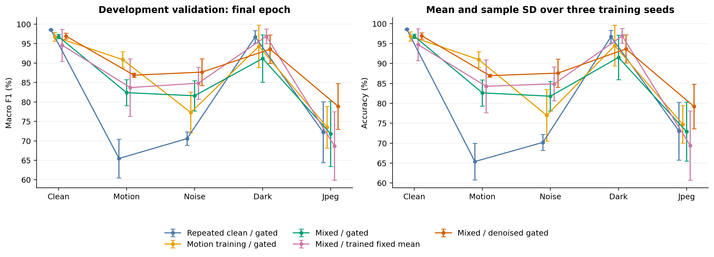
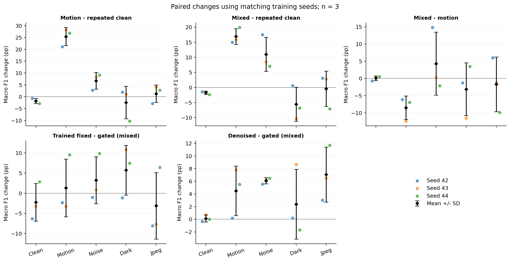
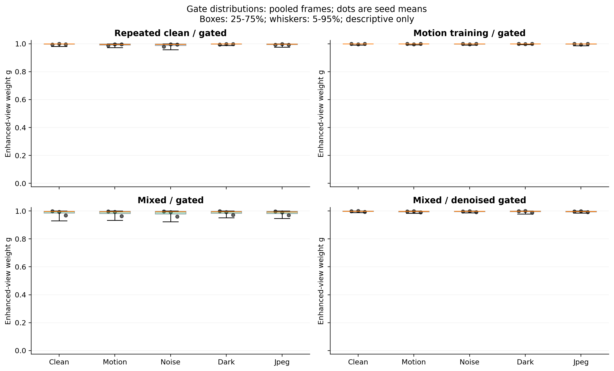
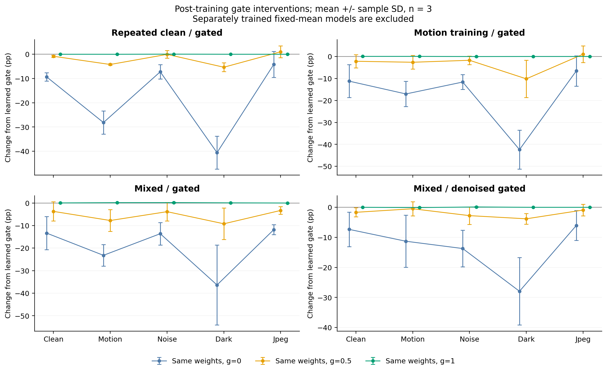
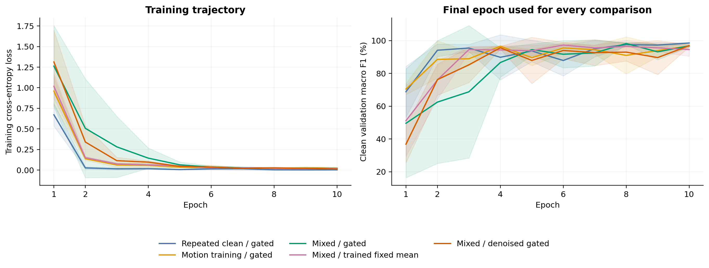

# C 部分：官方预训练 ResNet18 与既有融合消融报告

本报告汇总 Windows 上使用 NVIDIA GeForce RTX 4060 Ti 和 CUDA 完成的 15 次正式训练，评估范围为固定开发验证集。

本次对五种配置各运行三个种子，汇报最终第 10 轮的七类分类结果、配对差值、门控干预和成本。下述差值是固定开发划分上的描述结果，不能据此宣称已经通过独立测试或证明门控有因果机制。

核心结果：mixed 门控相对 targeted_motion 门控的噪声 Macro-F1 平均变化为 +4.30 pp，运动模糊为 -8.48 pp。去噪门控相对 mixed 门控的噪声差值为 +6.09 pp；预设描述性噪声收益检查满足。门控偏好及预测敏感性分别由实际分布和同权重干预结果描述。

## 1. 范围与可追溯证据

- 运行矩阵：门控双分支 × repeat_clean / targeted_motion / mixed × 42、43、44，共 9 次；mixed 下 fixed 与 dual_denoised 各三个种子，共 6 次。
- 类别顺序为 1、2、3、4、5、7、8。固定训练集 2,940 帧、98 条轨迹，开发验证集 840 帧、28 条轨迹，每条轨迹 30 帧，训练和验证没有轨迹交叉。
- 每次训练含 4,410 个条目，其中 2,940 张干净图和 1,470 个额外条目。repeat_clean 的额外条目是原图重复，不是新增独立图像；mixed 的三类干扰各 490 个条目。
- 本程序核验 15 个配置和完整性记录，独立复算 75 条常规指标及 180 条干预指标；共有 63,000 条常规验证预测、151,200 条干预预测和 90 个特征 NPZ。验证条件共用同一批 840 张图，不能将五种条件当成 4,200 个独立样本。
- 随报告公开[聚合指标](../../results/study_resnet18_rtx4060ti_v1/metrics.csv)、[逐图预测](../../results/study_resnet18_rtx4060ti_v1/predictions.csv)、[干预指标](../../results/study_resnet18_rtx4060ti_v1/intervention_metrics.csv)、[干预逐图预测](../../results/study_resnet18_rtx4060ti_v1/intervention_predictions.csv)和[核验清单](summary_manifest.json)。原始模型权重、特征与逐运行记录由训练机器保存。
- 本次未新增正式的 raw、CLAHE 或 denoised-CLAHE 单分支对照。历史 SmallCNN 结果与旧预实验分数均不混入当前 ResNet 表；骨干、ImageNet 初始化及输入尺寸同时变化，不能把两套结果解释为只隔离骨干结构的对照。B 已提交单分支汇总。输入像素和完整产物仍待对齐验收，统一官方测试另按全组协议执行。

## 2. 模型、训练与视图

共享骨干为 torchvision 官方 `resnet18`，以 `ResNet18_Weights.IMAGENET1K_V1` 的 ImageNet 权重初始化。保留官方卷积 stem、BatchNorm、残差层、下采样和平均池化，直接取平均池化后的 512 维表示，七类分类头替换官方 1,000 类头；不添加自定义残差块、stem、注意力或投影层。原图与增强图共享同一个编码器，并完整微调骨干与分类头。既有双视图融合和消融沿用项目方案，不作为新发明。学习门控由两路特征拼接经线性层和 sigmoid 生成标量 g，融合为 `(1-g)·z_raw + g·z_enhanced`。g 越大，增强视图权重越大。

缓存视图、合成干扰及 CLAHE 均先在既有 32×32 图上构建，再对每一批视图应用官方权重预处理 `Resize(256) → CenterCrop(224) → ImageNet Normalize`。配置的 `image_size=32` 指源视图尺寸，`network_input_size=224` 才是骨干输入；单分支与融合使用相同预处理，不加入随机裁剪或翻转。

fixed 模型独立训练，在相同官方 ImageNet 初始化后完整微调，并在所有样本上固定 g=0.5。dual_denoised 保留原图分支，将增强分支改为双边滤波后 CLAHE：`d=5, sigmaColor=25, sigmaSpace=2`。CLAHE 仅作用于 LAB 的 L 通道，`clipLimit=2.0, tileGridSize=(4,4)`。干扰先作用于 8 位受损图，再生成两种配对视图；增强分支不接收对应干净图。

统一使用 AdamW、学习率 0.003、weight decay 0.01、betas=(0.9, 0.999)、epsilon=1e-8、batch size 128 和 10 轮；每轮 35 次优化更新，共 350 步。三个种子为 42、43、44，所有结果都使用最终轮，不用各组最佳轮挑选成绩。clean、motion、noise、dark、jpeg 是当前五个开发条件；`severity` 的实际标记保留在 CSV，不能将这里的五条件结果写成 13 条件或多强度结论。JPEG 没有加入训练增强。

## 3. 最终轮开发验证结果

表内为 Macro-F1 百分比的三种子均值 ± 样本标准差（`ddof=1`）。准确率的相同统计见 [完整汇总](tables/metric_summary.csv)。标准差描述训练随机性；n=3 很小，不能解释为精确的总体误差或置信区间。

| 配置 | clean | motion | noise | dark | jpeg |
| --- | --- | --- | --- | --- | --- |
| Repeated clean / gated | 98.57 ± 0.12 | 65.47 ± 4.98 | 70.58 ± 1.76 | 96.73 ± 1.61 | 72.21 ± 7.82 |
| Motion training / gated | 96.76 ± 1.14 | 90.88 ± 2.05 | 77.29 ± 5.24 | 94.31 ± 5.41 | 73.50 ± 5.39 |
| Mixed / gated | 96.82 ± 0.56 | 82.39 ± 3.36 | 81.59 ± 3.91 | 91.18 ± 6.10 | 71.80 ± 8.36 |
| Mixed / trained fixed mean | 94.58 ± 4.12 | 83.70 ± 7.42 | 84.82 ± 4.15 | 96.89 ± 1.87 | 68.69 ± 8.79 |
| Mixed / denoised gated | 96.95 ± 0.78 | 86.88 ± 0.56 | 87.67 ± 3.44 | 93.57 ± 3.66 | 78.86 ± 5.89 |

## 4. 按种子配对的比较

每个差值使用同种子、同划分和同条件的两个模型，单位为百分点（pp）。表内的差值标准差直接由三条配对差值计算，不能由两组标准差相减替代。

| 比较（候选减参照） | 条件 | Macro-F1 差值均值 ± SD (pp) | 正差值种子 |
| --- | --- | --- | --- |
| targeted_minus_repeat | clean | -1.81 ± 1.08 | 0/3 |
| targeted_minus_repeat | motion | +25.41 ± 3.81 | 3/3 |
| targeted_minus_repeat | noise | +6.70 ± 3.49 | 3/3 |
| targeted_minus_repeat | dark | -2.42 ± 6.85 | 2/3 |
| targeted_minus_repeat | jpeg | +1.29 ± 3.68 | 2/3 |
| mixed_minus_repeat | clean | -1.75 ± 0.55 | 0/3 |
| mixed_minus_repeat | motion | +16.93 ± 2.61 | 3/3 |
| mixed_minus_repeat | noise | +11.00 ± 5.66 | 3/3 |
| mixed_minus_repeat | dark | -5.55 ± 5.63 | 1/3 |
| mixed_minus_repeat | jpeg | -0.41 ± 5.82 | 2/3 |
| mixed_minus_targeted | clean | +0.06 ± 0.66 | 2/3 |
| mixed_minus_targeted | motion | -8.48 ± 3.41 | 0/3 |
| mixed_minus_targeted | noise | +4.30 ± 9.15 | 2/3 |
| mixed_minus_targeted | dark | -3.13 ± 7.68 | 1/3 |
| mixed_minus_targeted | jpeg | -1.70 ± 7.95 | 1/3 |
| trained_fixed_minus_gated | clean | -2.24 ± 4.68 | 1/3 |
| trained_fixed_minus_gated | motion | +1.31 ± 7.13 | 1/3 |
| trained_fixed_minus_gated | noise | +3.24 ± 5.82 | 2/3 |
| trained_fixed_minus_gated | dark | +5.71 ± 6.16 | 2/3 |
| trained_fixed_minus_gated | jpeg | -3.11 ± 8.24 | 1/3 |
| denoised_minus_gated | clean | +0.13 ± 0.55 | 2/3 |
| denoised_minus_gated | motion | +4.49 ± 3.91 | 3/3 |
| denoised_minus_gated | noise | +6.09 ± 0.48 | 3/3 |
| denoised_minus_gated | dark | +2.39 ± 5.51 | 2/3 |
| denoised_minus_gated | jpeg | +7.06 ± 4.36 | 3/3 |

- **Motion training / gated 相对 Repeated clean / gated**：clean -1.81 pp（0/3 种子为正）；motion +25.41 pp（3/3 种子为正）；noise +6.70 pp（3/3 种子为正）；dark -2.42 pp（2/3 种子为正）；jpeg +1.29 pp（2/3 种子为正）。
- **Mixed / gated 相对 Repeated clean / gated**：clean -1.75 pp（0/3 种子为正）；motion +16.93 pp（3/3 种子为正）；noise +11.00 pp（3/3 种子为正）；dark -5.55 pp（1/3 种子为正）；jpeg -0.41 pp（2/3 种子为正）。
- **Mixed / gated 相对 Motion training / gated**：clean +0.06 pp（2/3 种子为正）；motion -8.48 pp（0/3 种子为正）；noise +4.30 pp（2/3 种子为正）；dark -3.13 pp（1/3 种子为正）；jpeg -1.70 pp（1/3 种子为正）。
- **Mixed / trained fixed mean 相对 Mixed / gated**：clean -2.24 pp（1/3 种子为正）；motion +1.31 pp（1/3 种子为正）；noise +3.24 pp（2/3 种子为正）；dark +5.71 pp（2/3 种子为正）；jpeg -3.11 pp（1/3 种子为正）。
- **Mixed / denoised gated 相对 Mixed / gated**：clean +0.13 pp（2/3 种子为正）；motion +4.49 pp（3/3 种子为正）；noise +6.09 pp（3/3 种子为正）；dark +2.39 pp（2/3 种子为正）；jpeg +7.06 pp（3/3 种子为正）。

这些比较完整保留收益和退步，属于描述性证据；当前没有进行显著性检验。去噪融合相对原门控在噪声至少 +2 pp、clean/motion 不低于 −1 pp、噪声至少 2/3 种子为正这一描述性检查：**满足**。这只对 C 的 mixed 门控参照成立；原计划的主要参照是 CLAHE 单分支，该正式对照仍待对齐输入并验收，项目的完整实践价值规则有待检验。

## 5. 门控分布与解释边界

下表先在每个运行的 840 帧上求门控均值，再对三个种子均值计算均值 ± SD。“各运行 5–95% 包络”是三个运行中 q05 的最小值至 q95 的最大值，用于观察分布，不是置信区间。逐运行的帧级均值、SD、最小值、5/25/50/75/95% 分位数、最大值及每类分布见 [gate_distribution.csv](tables/gate_distribution.csv)。固定平均模型的 g 恒为 0.5。

普通 dual 的验证门控最小值为 0.791475，g=1 干预共改变 54 条预测。应结合分布及下表逐运行值解释权重偏好，不能仅凭均值较高声称门控有输入自适应能力。

下表每行合并同一运行的五个验证条件（4,200 条预测），分别列出近饱和和数值上恰好为 1 的比例；这些重复图像实例用于描述，不是独立样本。

| 普通 dual 运行 | 最小 g | g≥0.99 比例 | g=1 比例 | 强制 g=1 改变预测数 |
| --- | --- | --- | --- | --- |
| mixed_dual_seed42 | 0.980507 | 98.00% | 0.00% | 5 |
| mixed_dual_seed43 | 0.951466 | 74.79% | 0.00% | 7 |
| mixed_dual_seed44 | 0.791475 | 23.90% | 0.00% | 34 |
| repeat_clean_dual_seed42 | 0.890557 | 71.07% | 0.00% | 3 |
| repeat_clean_dual_seed43 | 0.977727 | 95.21% | 0.00% | 1 |
| repeat_clean_dual_seed44 | 0.929582 | 86.14% | 0.00% | 0 |
| targeted_motion_dual_seed42 | 0.988482 | 99.98% | 0.00% | 1 |
| targeted_motion_dual_seed43 | 0.957002 | 87.45% | 0.00% | 3 |
| targeted_motion_dual_seed44 | 0.994824 | 100.00% | 0.00% | 0 |

| 配置 | 条件 | 运行门控均值 ± 种子 SD | 各运行 5–95% 包络 |
| --- | --- | --- | --- |
| Repeated clean / gated | clean | 0.9968 ± 0.0020 | 0.9713–1.0000 |
| Repeated clean / gated | motion | 0.9928 ± 0.0047 | 0.9562–0.9999 |
| Repeated clean / gated | noise | 0.9901 ± 0.0093 | 0.9402–1.0000 |
| Repeated clean / gated | dark | 0.9971 ± 0.0017 | 0.9859–1.0000 |
| Repeated clean / gated | jpeg | 0.9946 ± 0.0022 | 0.9700–0.9999 |
| Motion training / gated | clean | 0.9986 ± 0.0019 | 0.9832–1.0000 |
| Motion training / gated | motion | 0.9985 ± 0.0018 | 0.9831–1.0000 |
| Motion training / gated | noise | 0.9980 ± 0.0019 | 0.9828–1.0000 |
| Motion training / gated | dark | 0.9990 ± 0.0013 | 0.9902–1.0000 |
| Motion training / gated | jpeg | 0.9974 ± 0.0032 | 0.9761–1.0000 |
| Mixed / gated | clean | 0.9870 ± 0.0164 | 0.8893–1.0000 |
| Mixed / gated | motion | 0.9850 ± 0.0181 | 0.8889–1.0000 |
| Mixed / gated | noise | 0.9834 ± 0.0205 | 0.8884–1.0000 |
| Mixed / gated | dark | 0.9878 ± 0.0139 | 0.9147–1.0000 |
| Mixed / gated | jpeg | 0.9864 ± 0.0140 | 0.9140–1.0000 |
| Mixed / denoised gated | clean | 0.9972 ± 0.0036 | 0.9832–1.0000 |
| Mixed / denoised gated | motion | 0.9957 ± 0.0048 | 0.9727–1.0000 |
| Mixed / denoised gated | noise | 0.9964 ± 0.0037 | 0.9782–1.0000 |
| Mixed / denoised gated | dark | 0.9956 ± 0.0064 | 0.9665–1.0000 |
| Mixed / denoised gated | jpeg | 0.9959 ± 0.0042 | 0.9783–1.0000 |

g 随条件或类别变化只说明当前模型的权重分配与这些分组相关，不能证明门控“识别了噪声”、不能把 g 当成解释性交通语义，也不能由分布变化推出性能收益的因果机制。图中为重复使用的帧分布，帧与同轨迹图像相关；没有把这些帧当成独立重复来生成推断区间。

## 6. 同一权重下的门控干预

本节仅在已经训练好的 learned 模型上替换 g，保持编码器和分类头权重不变。g=0 使用原图特征，g=1 使用增强视图特征，g=0.5 使用两者平均。端点分支仍是在融合训练过程中共同学习得到，不能作为独立训练的单分支模型。这里的 g=0.5 干预与第 3 节独立训练的 fixed 模型是两种不同实验。

| 训练配置 | 条件 | 干预 g | Macro-F1 (%) 均值 ± SD | 相对学习门控 Δ (pp) 均值 ± SD |
| --- | --- | --- | --- | --- |
| Mixed / gated | clean | 0 | 83.47 ± 7.14 | -13.35 ± 7.35 |
| Mixed / gated | clean | 0.5 | 93.10 ± 4.14 | -3.72 ± 4.26 |
| Mixed / gated | clean | 1 | 96.86 ± 0.50 | +0.04 ± 0.07 |
| Mixed / gated | dark | 0 | 54.83 ± 23.38 | -36.35 ± 17.73 |
| Mixed / gated | dark | 0.5 | 81.97 ± 13.03 | -9.21 ± 6.97 |
| Mixed / gated | dark | 1 | 91.26 ± 5.98 | +0.08 ± 0.13 |
| Mixed / gated | jpeg | 0 | 60.00 ± 8.06 | -11.80 ± 2.18 |
| Mixed / gated | jpeg | 0.5 | 68.51 ± 9.85 | -3.29 ± 1.72 |
| Mixed / gated | jpeg | 1 | 71.80 ± 8.36 | -0.00 ± 0.00 |
| Mixed / gated | motion | 0 | 59.19 ± 6.68 | -23.20 ± 4.77 |
| Mixed / gated | motion | 0.5 | 74.63 ± 7.25 | -7.76 ± 4.83 |
| Mixed / gated | motion | 1 | 82.56 ± 3.42 | +0.16 ± 0.06 |
| Mixed / gated | noise | 0 | 67.97 ± 4.67 | -13.61 ± 4.97 |
| Mixed / gated | noise | 0.5 | 77.75 ± 5.66 | -3.84 ± 4.12 |
| Mixed / gated | noise | 1 | 81.77 ± 3.74 | +0.18 ± 0.23 |
| Mixed / denoised gated | clean | 0 | 89.61 ± 6.34 | -7.34 ± 5.76 |
| Mixed / denoised gated | clean | 0.5 | 95.29 ± 2.18 | -1.65 ± 1.52 |
| Mixed / denoised gated | clean | 1 | 96.95 ± 0.78 | +0.00 ± 0.00 |
| Mixed / denoised gated | dark | 0 | 65.63 ± 14.85 | -27.94 ± 11.21 |
| Mixed / denoised gated | dark | 0.5 | 89.75 ± 5.31 | -3.82 ± 1.75 |
| Mixed / denoised gated | dark | 1 | 93.57 ± 3.65 | +0.00 ± 0.00 |
| Mixed / denoised gated | jpeg | 0 | 72.81 ± 6.65 | -6.05 ± 4.98 |
| Mixed / denoised gated | jpeg | 0.5 | 77.95 ± 5.97 | -0.91 ± 1.96 |
| Mixed / denoised gated | jpeg | 1 | 78.86 ± 5.89 | -0.00 ± 0.00 |
| Mixed / denoised gated | motion | 0 | 75.59 ± 8.45 | -11.29 ± 8.67 |
| Mixed / denoised gated | motion | 0.5 | 86.40 ± 2.15 | -0.48 ± 2.32 |
| Mixed / denoised gated | motion | 1 | 86.80 ± 0.49 | -0.08 ± 0.07 |
| Mixed / denoised gated | noise | 0 | 73.96 ± 8.44 | -13.71 ± 6.07 |
| Mixed / denoised gated | noise | 0.5 | 84.91 ± 5.70 | -2.76 ± 2.90 |
| Mixed / denoised gated | noise | 1 | 87.80 ± 3.43 | +0.12 ± 0.12 |
| Repeated clean / gated | clean | 0 | 89.23 ± 1.69 | -9.34 ± 1.73 |
| Repeated clean / gated | clean | 0.5 | 97.75 ± 0.35 | -0.82 ± 0.46 |
| Repeated clean / gated | clean | 1 | 98.57 ± 0.12 | +0.00 ± 0.00 |
| Repeated clean / gated | dark | 0 | 56.16 ± 5.34 | -40.57 ± 6.74 |
| Repeated clean / gated | dark | 0.5 | 91.38 ± 2.37 | -5.34 ± 1.84 |
| Repeated clean / gated | dark | 1 | 96.73 ± 1.61 | +0.00 ± 0.00 |
| Repeated clean / gated | jpeg | 0 | 68.06 ± 3.76 | -4.16 ± 5.34 |
| Repeated clean / gated | jpeg | 0.5 | 73.24 ± 5.40 | +1.03 ± 2.45 |
| Repeated clean / gated | jpeg | 1 | 72.21 ± 7.82 | -0.00 ± 0.01 |
| Repeated clean / gated | motion | 0 | 37.31 ± 8.53 | -28.16 ± 4.75 |
| Repeated clean / gated | motion | 0.5 | 61.25 ± 4.76 | -4.22 ± 0.34 |
| Repeated clean / gated | motion | 1 | 65.46 ± 4.97 | -0.01 ± 0.01 |
| Repeated clean / gated | noise | 0 | 63.35 ± 3.91 | -7.23 ± 2.94 |
| Repeated clean / gated | noise | 0.5 | 70.54 ± 3.20 | -0.04 ± 1.58 |
| Repeated clean / gated | noise | 1 | 70.64 ± 1.67 | +0.06 ± 0.09 |
| Motion training / gated | clean | 0 | 85.53 ± 8.59 | -11.23 ± 7.48 |
| Motion training / gated | clean | 0.5 | 94.57 ± 4.03 | -2.19 ± 3.02 |
| Motion training / gated | clean | 1 | 96.80 ± 1.13 | +0.04 ± 0.07 |
| Motion training / gated | dark | 0 | 51.93 ± 13.69 | -42.38 ± 8.82 |
| Motion training / gated | dark | 0.5 | 84.13 ± 13.89 | -10.18 ± 8.47 |
| Motion training / gated | dark | 1 | 94.31 ± 5.41 | +0.00 ± 0.00 |
| Motion training / gated | jpeg | 0 | 66.91 ± 7.76 | -6.60 ± 6.88 |
| Motion training / gated | jpeg | 0.5 | 74.53 ± 6.23 | +1.02 ± 3.82 |
| Motion training / gated | jpeg | 1 | 73.50 ± 5.40 | -0.00 ± 0.00 |
| Motion training / gated | motion | 0 | 73.82 ± 7.57 | -17.06 ± 5.72 |
| Motion training / gated | motion | 0.5 | 88.24 ± 4.70 | -2.63 ± 3.10 |
| Motion training / gated | motion | 1 | 90.92 ± 2.09 | +0.04 ± 0.07 |
| Motion training / gated | noise | 0 | 65.65 ± 2.75 | -11.64 ± 3.35 |
| Motion training / gated | noise | 0.5 | 75.55 ± 3.29 | -1.74 ± 1.96 |
| Motion training / gated | noise | 1 | 77.25 ± 5.22 | -0.04 ± 0.06 |

干预表反映改变当前融合规则时的预测敏感性，不能单独证明门控的学习机制在真实场景中具有因果优势。完整逐种子结果见 [intervention_by_run.csv](tables/intervention_by_run.csv)。

## 7. 训练状态与固定轮数的限制

表内“最佳轮”仅作为训练状态诊断，不参与模型选择。15 次运行末轮相对各自最佳 clean 验证分数的最大落差为 7.75 pp，最后一轮 clean 分数变化范围为 -4.22 至 +17.76 pp。有限的 10 轮轨迹不能证明全部模型充分收敛；若末端仍变化，应在后续统一协议中检验更长训练，而不能只延长某个落后配置。

| 运行 | 首轮 → 末轮训练损失 | 末轮损失变化 | 末轮验证变化 (pp) | 诊断最佳轮 | 末轮减最佳 (pp) |
| --- | --- | --- | --- | --- | --- |
| mixed_dual_denoised_seed42 | 0.8708 → 0.0059 | -0.0157 | -2.03 | 9 | -2.03 |
| mixed_dual_denoised_seed43 | 1.5339 → 0.0074 | -0.0108 | +6.07 | 10 | +0.00 |
| mixed_dual_denoised_seed44 | 1.5335 → 0.0263 | +0.0021 | +17.76 | 10 | +0.00 |
| mixed_dual_seed42 | 0.7472 → 0.0175 | -0.0112 | +9.57 | 6 | -1.79 |
| mixed_dual_seed43 | 1.3111 → 0.0247 | +0.0109 | +0.21 | 8 | -1.79 |
| mixed_dual_seed44 | 1.7285 → 0.0239 | +0.0011 | +1.15 | 8 | -2.15 |
| mixed_fixed_seed42 | 0.8601 → 0.0211 | +0.0054 | -4.22 | 8 | -7.75 |
| mixed_fixed_seed43 | 1.1594 → 0.0238 | +0.0127 | +0.18 | 8 | -4.71 |
| mixed_fixed_seed44 | 1.0321 → 0.0157 | -0.0077 | +0.95 | 10 | +0.00 |
| repeat_clean_dual_seed42 | 0.5968 → 0.0001 | -0.0000 | +0.60 | 10 | +0.00 |
| repeat_clean_dual_seed43 | 0.8309 → 0.0082 | +0.0032 | +2.93 | 10 | +0.00 |
| repeat_clean_dual_seed44 | 0.5864 → 0.0004 | -0.0008 | +0.24 | 10 | +0.00 |
| targeted_motion_dual_seed42 | 0.8605 → 0.0079 | -0.0047 | -0.25 | 9 | -0.25 |
| targeted_motion_dual_seed43 | 1.1543 → 0.0256 | +0.0032 | +4.56 | 8 | -0.75 |
| targeted_motion_dual_seed44 | 0.8618 → 0.0330 | -0.0121 | +4.13 | 6 | -1.80 |

## 8. 参数与时间成本

表内为三种子均值 ± 样本 SD。训练共计 25462.52 秒（累加各次记录，不代表并行任务的实际总墙钟时间）；训练计时排除逐轮验证和导出。所有运行的线程数相同。 前向记录包括已准备的 32×32 视图的批次选择、设备传输、模型内部的官方 Resize/CenterCrop/Normalize、ResNet 前向及 CPU 输出收集，按同一批验证图摊算；它不包括源 PPM 磁盘读取或 32×32 干扰/CLAHE 视图缓存构建，且不是逐张在线延迟的测量。训练、导出和各评估条件前向耗时分别见 [逐运行成本](tables/cost_by_run.csv) 与 [条件耗时](tables/inference_cost.csv)。`preprocessing_seconds` 记录的是 CPU 源视图构建，每次同时生成 raw、CLAHE 和 denoised-CLAHE 三种视图，可被各运行复用，不应再次加总为独立执行成本，也不能拆解为某种单视图方法的耗时。

| 配置 | 参数 | 线程 | 训练 (s) | 导出 (s) | clean 前向 (ms/图) |
| --- | --- | --- | --- | --- | --- |
| Repeated clean / gated | 11181128 | 6 | 1674.35 ± 45.58 | 93.45 ± 1.32 | 4.5600 ± 0.2914 |
| Motion training / gated | 11181128 | 6 | 1247.66 ± 161.95 | 65.11 ± 0.45 | 3.2435 ± 0.0551 |
| Mixed / gated | 11181128 | 6 | 1163.42 ± 18.23 | 64.68 ± 0.32 | 3.1144 ± 0.0897 |
| Mixed / trained fixed mean | 11180103 | 6 | 929.55 ± 302.21 | 17.84 ± 6.20 | 2.2793 ± 0.9086 |
| Mixed / denoised gated | 11181128 | 6 | 3472.53 ± 2586.33 | 264.23 ± 398.66 | 23.9027 ± 38.5932 |

这些成本只对应记录中的环境及当前执行方式。预处理对去噪方案的代价需要与前向耗时分开看。

本次十五次矩阵没有 raw 单分支计时对照，因此无法从正式表量化融合相对单分支的额外前向成本。工程小样本核验与历史 SmallCNN 计时不混入本研究。应在同一机器、线程、视图和计时方法下补做重复测量。

## 9. 核验、局限与后续交接

汇总程序先执行 `verify_completed_run(run_dir, config)` 检查每个运行，再独立检查矩阵、固定协议、七类标签、75 条常规指标、180 条干预指标、预测重复、图像/轨迹/标签配对、六个 NPZ 的 512 维特征及元数据，以及末轮训练日志与导出指标一致性。Macro-F1 始终固定包含全部七类，零分母类别按 0 计；准确率从逐图预测重算。完整 source 文件 SHA-256 及生成时间保留于 [summary_manifest.json](summary_manifest.json)。

官方权重来源为 `ResNet18_Weights.IMAGENET1K_V1`，完整 SHA-256 为 `f37072fd47e89c5e827621c5baffa7500819f7896bbacec160b1a16c560e07ec`，记录的 torchvision 为 `0.20.1`。汇总前核对项目内权重文件的完整校验和；不会下载或替换权重。

研究根部 `run_config.json` 的矩阵必须与十五种组合完全一致；研究内 `split.csv` 的完整字节 SHA-256 必须等于公共配置，`data_manifest.json` 的字段与训练入口一致，并从源文件记录、原始划分顺序及三种训练/五种验证像素指纹独立重算稳定数据指纹。汇总不重新生成像素，也不要求当前训练代码哈希与历史快照相同。每次运行去掉运行 ID、种子、输入、增强和预处理计时字段后，其余所有配置字段必须与研究公共配置逐项相等，缺失或额外字段都会拒绝汇总。

本报告生成时未发现已通过的独立权重重载核验记录；指纹完整性与 NPZ/CSV 对齐检查不代替重载执行。

当前报告限定于七类、一个固定开发划分、28 条验证轨迹、合成干扰、五个条件和三个训练种子。不同帧、条件、种子都复用同一验证图，不能把 63,000 行当成 63,000 个独立观测。本文没有构建逐帧 IID 置信区间；D 如需配对 bootstrap，应以整条轨迹为单位、按类别分层，在一次重采样中同时保留所有条件与配对种子，并明确区间仅描述这一固定开发划分。

后续由 A/B 补齐正式单分支对照与统一多强度评估，由 D 在干净训练特征上拟合 PCA/KMeans 并验证开发表示，不在验证特征上拟合后报告泛化。全组先冻结候选清单再打开官方七类测试集。官方测试未在本报告中使用，也不能把本报告趋势外推到全部 43 类或真实道路。

复现命令、产物契约、失败处理及环境信息入口见 [README](README.md)。

## 附录：全部逐种子配对差值

| 比较 | 条件 | 种子 | Macro-F1 Δ (pp) |
| --- | --- | --- | --- |
| targeted_minus_repeat | clean | 42 | -0.726 |
| targeted_minus_repeat | clean | 43 | -1.824 |
| targeted_minus_repeat | clean | 44 | -2.882 |
| targeted_minus_repeat | motion | 42 | +21.096 |
| targeted_minus_repeat | motion | 43 | +28.295 |
| targeted_minus_repeat | motion | 44 | +26.838 |
| targeted_minus_repeat | noise | 42 | +2.711 |
| targeted_minus_repeat | noise | 43 | +8.230 |
| targeted_minus_repeat | noise | 44 | +9.167 |
| targeted_minus_repeat | dark | 42 | +1.909 |
| targeted_minus_repeat | dark | 43 | +1.148 |
| targeted_minus_repeat | dark | 44 | -10.314 |
| targeted_minus_repeat | jpeg | 42 | -2.899 |
| targeted_minus_repeat | jpeg | 43 | +4.013 |
| targeted_minus_repeat | jpeg | 44 | +2.752 |
| mixed_minus_repeat | clean | 42 | -1.431 |
| mixed_minus_repeat | clean | 43 | -1.435 |
| mixed_minus_repeat | clean | 44 | -2.393 |
| mixed_minus_repeat | motion | 42 | +14.981 |
| mixed_minus_repeat | motion | 43 | +15.905 |
| mixed_minus_repeat | motion | 44 | +19.893 |
| mixed_minus_repeat | noise | 42 | +17.486 |
| mixed_minus_repeat | noise | 43 | +8.488 |
| mixed_minus_repeat | noise | 44 | +7.033 |
| mixed_minus_repeat | dark | 42 | +0.626 |
| mixed_minus_repeat | dark | 43 | -10.410 |
| mixed_minus_repeat | dark | 44 | -6.852 |
| mixed_minus_repeat | jpeg | 42 | +3.086 |
| mixed_minus_repeat | jpeg | 43 | +2.815 |
| mixed_minus_repeat | jpeg | 44 | -7.130 |
| mixed_minus_targeted | clean | 42 | -0.705 |
| mixed_minus_targeted | clean | 43 | +0.390 |
| mixed_minus_targeted | clean | 44 | +0.490 |
| mixed_minus_targeted | motion | 42 | -6.115 |
| mixed_minus_targeted | motion | 43 | -12.390 |
| mixed_minus_targeted | motion | 44 | -6.946 |
| mixed_minus_targeted | noise | 42 | +14.775 |
| mixed_minus_targeted | noise | 43 | +0.258 |
| mixed_minus_targeted | noise | 44 | -2.134 |
| mixed_minus_targeted | dark | 42 | -1.282 |
| mixed_minus_targeted | dark | 43 | -11.559 |
| mixed_minus_targeted | dark | 44 | +3.463 |
| mixed_minus_targeted | jpeg | 42 | +5.985 |
| mixed_minus_targeted | jpeg | 43 | -1.199 |
| mixed_minus_targeted | jpeg | 44 | -9.882 |
| trained_fixed_minus_gated | clean | 42 | -6.314 |
| trained_fixed_minus_gated | clean | 43 | -3.277 |
| trained_fixed_minus_gated | clean | 44 | +2.866 |
| trained_fixed_minus_gated | motion | 42 | -2.347 |
| trained_fixed_minus_gated | motion | 43 | -3.251 |
| trained_fixed_minus_gated | motion | 44 | +9.533 |
| trained_fixed_minus_gated | noise | 42 | -1.000 |
| trained_fixed_minus_gated | noise | 43 | +0.835 |
| trained_fixed_minus_gated | noise | 44 | +9.877 |
| trained_fixed_minus_gated | dark | 42 | -1.138 |
| trained_fixed_minus_gated | dark | 43 | +10.822 |
| trained_fixed_minus_gated | dark | 44 | +7.433 |
| trained_fixed_minus_gated | jpeg | 42 | -8.080 |
| trained_fixed_minus_gated | jpeg | 43 | -7.658 |
| trained_fixed_minus_gated | jpeg | 44 | +6.398 |
| denoised_minus_gated | clean | 42 | -0.357 |
| denoised_minus_gated | clean | 43 | +0.725 |
| denoised_minus_gated | clean | 44 | +0.015 |
| denoised_minus_gated | motion | 42 | +0.163 |
| denoised_minus_gated | motion | 43 | +7.778 |
| denoised_minus_gated | motion | 44 | +5.523 |
| denoised_minus_gated | noise | 42 | +5.552 |
| denoised_minus_gated | noise | 43 | +6.236 |
| denoised_minus_gated | noise | 44 | +6.475 |
| denoised_minus_gated | dark | 42 | +0.189 |
| denoised_minus_gated | dark | 43 | +8.658 |
| denoised_minus_gated | dark | 44 | -1.690 |
| denoised_minus_gated | jpeg | 42 | +3.014 |
| denoised_minus_gated | jpeg | 43 | +6.487 |
| denoised_minus_gated | jpeg | 44 | +11.669 |
